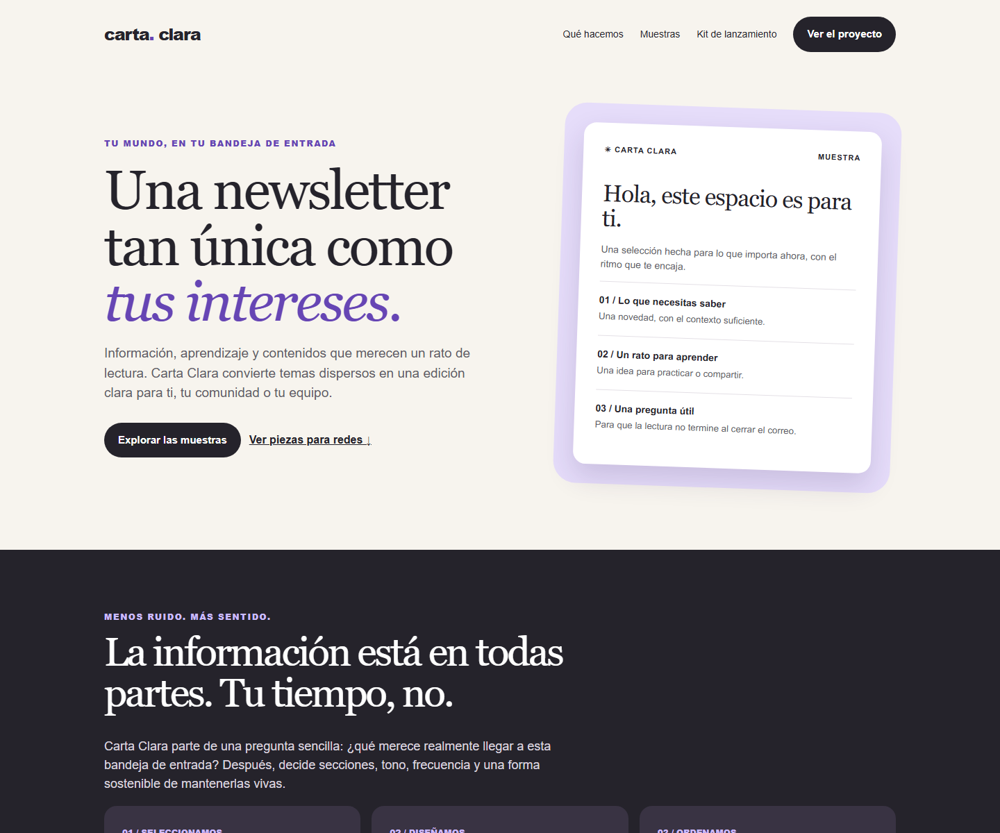

# Carta Clara

Una marca editorial que diseña newsletters claras, útiles y agradables de leer para personas, profesionales, academias y pequeños equipos.

> Menos ruido. Más ideas que importan.

Este repositorio reúne la web de presentación, ejemplos de newsletters, piezas para redes y la guía básica de la marca. Todo el contenido es demostrativo: no representa clientes, resultados ni suscripciones activas.



## Qué incluye

- Una landing y galería de muestras en [`dist/`](dist/).
- Seis conceptos de newsletter en [`templates/newsletters/`](templates/newsletters/).
- Creatividades editables para Instagram y miniaturas de YouTube en [`dist/assets/social/`](dist/assets/social/).
- Capturas PNG ya exportadas junto a cada SVG, listas para revisar antes de publicar.
- Textos de publicaciones y guiones breves en [`content/social/`](content/social/).
- Guía de tono, uso visual y publicación en [`docs/`](docs/).

## Abrir la web localmente

No necesita instalación ni dependencias. Abre [`dist/index.html`](dist/index.html) en tu navegador. La página usa HTML y CSS sin framework para que sea fácil de mantener y de publicar como sitio estático.

## Muestras incluidas

| Concepto | Para quién | Promesa editorial |
| --- | --- | --- |
| Radar | Profesionales | Las novedades de un sector, con contexto y fuentes. |
| Aula | Academias y docentes | Una pequeña lección, práctica y motivación semanal. |
| Entrena | Deportistas y centros | Una pauta útil para entrenar con intención. |
| Idioma en marcha | Estudiantes | Una idea de idioma que se pueda practicar en minutos. |
| Equipo al día | Pequeñas empresas | Información interna que conecta sin saturar. |
| Pausa | Personas curiosas | Lecturas y hábitos para bajar el ritmo sin perder el hilo. |

## Publicación

1. Revisa el nombre de marca, usuarios y dominio antes de hacer comunicación pública.
2. Sustituye los contenidos de ejemplo por fuentes, datos y datos de contacto reales.
3. Para email comercial, valida previamente la base jurídica, privacidad, bajas y permisos aplicables.
4. Exporta los SVG de redes a PNG/JPG desde Figma, Canva, Illustrator o tu editor preferido antes de subirlos a Instagram o YouTube.

## Estructura

```text
.
├── content/social/          # Copies, llamadas a la acción y guiones
├── dist/                    # Web estática lista para hosting
│   └── assets/social/       # Arte maestro SVG para Instagram y YouTube
├── docs/                    # Marca, catálogo y guía de publicación
└── templates/newsletters/   # Ediciones ficticias que sirven de demostración
```

## Principios de Carta Clara

- Seleccionar antes que acumular.
- Explicar antes que impresionar.
- Diferenciar siempre una muestra ficticia de un servicio real.
- Atribuir y enlazar las fuentes originales.
- Diseñar para lectura móvil, claridad y accesibilidad.

## Próximos pasos recomendados

- Elegir el nicho inicial y hablar con cinco posibles personas clientes.
- Preparar dos pilotos pagados con alcance, revisión y fecha de fin definidos.
- Registrar dominio y configurar un canal de contacto real.
- Crear las primeras piezas con fuentes y permisos comprobados.

Consulta el [catálogo de newsletter](docs/CATALOGO-DE-NEWSLETTERS.md) y la [guía de activos](docs/ASSETS-Y-PUBLICACION.md) antes de publicar.
