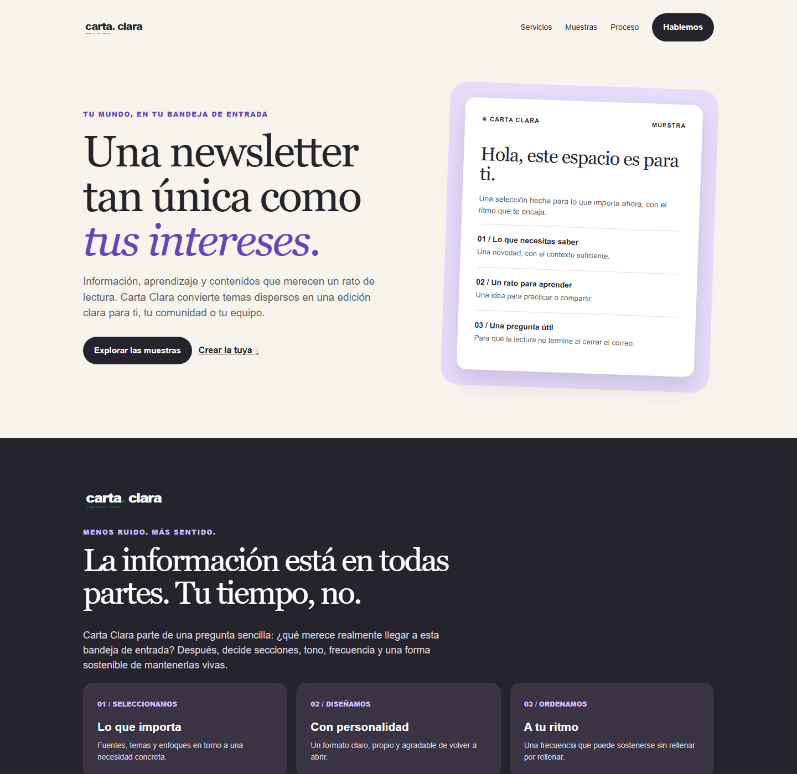

# Carta Clara

Una marca editorial que diseña newsletters claras, útiles y agradables de leer para personas, profesionales, academias y pequeños equipos.

> Menos ruido. Más ideas que importan.

Este repositorio reúne la web de presentación, ejemplos de newsletters, piezas para redes y la guía básica de la marca. Todo el contenido es demostrativo: no representa clientes, resultados ni suscripciones activas.



## Qué incluye

- Una landing y galería de muestras en [`dist/`](dist/).
- Nueve conceptos de newsletter en [`plantillas-boletines/modelos/`](plantillas-boletines/modelos/).
- Creatividades editables y sus PNG finales en [`dist/recursos/redes-sociales/`](dist/recursos/redes-sociales/).
- Capturas PNG ya exportadas junto a cada SVG, listas para revisar antes de publicar.
- Textos de publicaciones y guiones breves en [`contenido-redes/publicaciones/`](contenido-redes/publicaciones/).
- Guía de tono, uso visual y publicación en [`documentacion/`](documentacion/).
- Código sin dependencias para generar las nueve newsletters en [`generador-boletines/`](generador-boletines/).

## Abrir la web localmente

No necesita instalación ni dependencias. Abre [`dist/index.html`](dist/index.html) en tu navegador. La página usa HTML y CSS sin framework para que sea fácil de mantener y de publicar como sitio estático.

## Muestras incluidas

| Concepto | Para quién | Promesa editorial |
| --- | --- | --- |
| Al día | Personas que quieren estar actualizadas | Noticias de una zona, una temática o un enfoque editorial con fuentes. |
| Aula | Academias y docentes | Una pequeña lección, práctica y motivación semanal. |
| Entrena | Deportistas y centros | Una pauta útil para entrenar con intención. |
| Idioma en marcha | Estudiantes | Una idea de idioma que se pueda practicar en minutos. |
| Equipo al día | Pequeñas empresas | Información interna que conecta sin saturar. |
| Pausa | Personas curiosas | Lecturas y hábitos para bajar el ritmo sin perder el hilo. |
| Comer bien | Personas que disfrutan cocinar | Recetas, temporada y compra cotidiana con más intención. |
| Huerto en marcha | Huertos y agricultura a pequeña escala | Tareas, plantas y calendario de cultivo. |
| Rumbo profesional | Personas que buscan empleo | Ofertas, recursos y pasos de candidatura para un objetivo concreto. |

## Publicación

1. Revisa el nombre de marca, usuarios y dominio antes de hacer comunicación pública.
2. Sustituye los contenidos de ejemplo por fuentes, datos y datos de contacto reales.
3. Para email comercial, valida previamente la base jurídica, privacidad, bajas y permisos aplicables.
4. Exporta los SVG de redes a PNG/JPG desde Figma, Canva, Illustrator o tu editor preferido antes de subirlos a Instagram o YouTube.

## Estructura

```text
.
├── contenido-redes/             # Copies, llamadas a la acción y guiones
├── documentacion/               # Marca, catálogo y guía de publicación
├── generador-boletines/         # Código que crea las nueve newsletters HTML
├── plantillas-boletines/        # Estructuras editoriales de cada modelo
└── dist/                        # Carpeta técnica que publica el hosting
    └── recursos/redes-sociales/ # SVG editables y PNG finales para redes
```

## Principios de Carta Clara

- Seleccionar antes que acumular.
- Explicar antes que impresionar.
- Diferenciar siempre una muestra ficticia de un servicio real.
- Atribuir y enlazar las fuentes originales.
- Diseñar para lectura móvil, claridad y accesibilidad.

## Próximos pasos recomendados

- Elegir el nicho inicial y hablar con cinco posibles personas clientes.
- Preparar dos pilotos pagados con alcance, revisión y fecha de fin definidos.
- Registrar dominio y configurar un canal de contacto real.
- Crear las primeras piezas con fuentes y permisos comprobados.

Consulta el [catálogo de newsletters](documentacion/CATALOGO-DE-NEWSLETTERS.md), la [guía de activos](documentacion/ASSETS-Y-PUBLICACION.md) y el [generador](generador-boletines/README.md) antes de publicar.

## Enseñarla con Netlify

La carpeta que se publica es `dist/`. Para compartir una versión rápidamente, arrastra esa carpeta a [Netlify Drop](https://app.netlify.com/drop). Consulta la [guía para Netlify](documentacion/PUBLICAR-EN-NETLIFY.md) para los pasos y para conectar GitHub más adelante.
